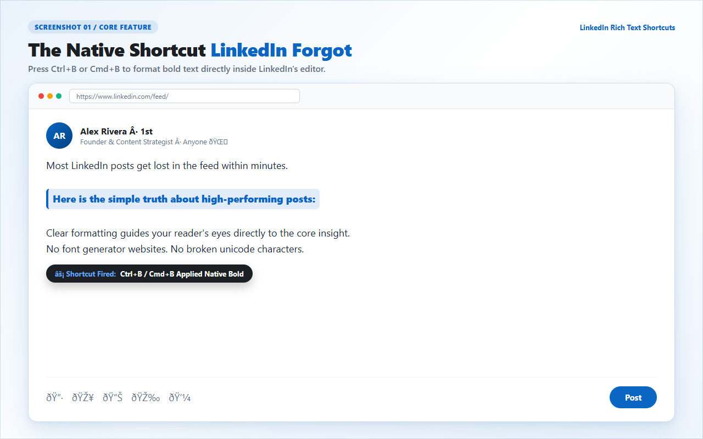

# LinkedIn Rich Text Shortcuts

[](src/manifest.json)
[](https://chromewebstore.google.com/detail/linkedin-rich-text-shortc/pcnojfgoolblflomemlceeemfjdmneia)
[](.ai/evals/content-script.test.js)
[](store-assets/privacy-policy.md)
[](LICENSE)
[]()

> Turn selected text bold in LinkedIn with standard `Ctrl+B` or `Cmd+B`. Native formatting. Zero external tabs. Zero tracking.

<p align="center">
  <a href="https://chromewebstore.google.com/detail/linkedin-rich-text-shortc/pcnojfgoolblflomemlceeemfjdmneia">
    
  </a>
</p>

<p align="center">
  
</p>

---

## The Problem: The "Unicode Trap"

Every modern editor on earth supports `Ctrl+B` or `Cmd+B`: Google Docs, Slack, Notion, Word, and Gmail.

You open LinkedIn to draft a post. You highlight a sentence and hit `Ctrl+B`. Nothing happens.

To emphasize text today, most creators use web-based font generators like YayText or LingoJam. You copy your sentence, paste it into another tab, copy weird characters, and paste them back.

That workflow is annoying. More importantly, it hurts your audience and your reach.

External generators do not produce real bold text. They paste mathematical alphanumeric symbols from the Unicode registry (such as `U+1D400` to `U+1D433`). 

Here is what happens when you use fake Unicode fonts:

| Evaluation Factor | Fake Unicode Generators (YayText, etc.) | Native Bold (`LinkedIn Rich Text Shortcuts`) |
|---|---|---|
| **Screen Reader Accessibility** | **Fails completely.** Reads aloud as "Mathematical Bold Capital H, Mathematical Bold Small e..." | **100% Accessible.** Screen readers pronounce words naturally and convey proper semantic emphasis. |
| **Search Engine & Feed Indexing** | **Breaks indexing.** LinkedIn search treats pseudo-symbols as unknown glyphs, hiding your post from searches. | **Full Search Reach.** Indexed as standard UTF-8 characters. Your keywords show up in search results. |
| **Publishing Workflow** | **4 disruptive steps.** Switch tabs, paste draft, pick a font, copy, switch back, paste. | **1 keystroke.** Highlight your text and hit `Ctrl+B` (or `Cmd+B`). |
| **Cross-Device Rendering** | **Frequent tofu boxes.** Older Android phones and desktop browsers render missing glyphs as empty boxes (`[]`). | **Native System Typography.** Matches LinkedIn's clean interface font across phones, tablets, and computers. |
| **Editability After Pasting** | **Uneditable.** You cannot undo bold partially. You have to re-type the sentence from scratch. | **Native Toggle.** Hit `Ctrl+B` again to remove bold. Keep typing without weird artifacts. |

---

## Keyboard Shortcuts

The extension automatically detects your operating system:

| Platform | Shortcut | Action |
|---|---|---|
| **Windows & Linux** | `Ctrl + B` | Toggle bold on active selection |
| **macOS** | `Cmd + B` | Toggle bold on active selection |

### Why Bold Only?

LinkedIn's underlying Tiptap and ProseMirror editor supports native bold (`<strong>` tags). It does not support native italics or underline in standard feed posts and comments.

Other tools promise italics by injecting Unicode hacks. We refuse to compromise your post accessibility or search reach. This extension does one job and does it right.

---

## Developer Quickstart (Bun-First)

This project uses the fast [Bun](https://bun.sh) runtime for development and testing.

### Prerequisites

Install [Bun](https://bun.sh) on your machine:

```bash
bun --version
```

### 1. Clone the Repository

```bash
git clone https://github.com/bhanubais/bold-text-on-linkedin.git
cd bold-text-on-linkedin
```

### 2. Run Automated Tests

Execute the 7 automated unit and integration tests:

```bash
bun test
```

The entire test suite executes in under 30ms:

```text
bun test v1.4.4
.ai/evals/content-script.test.js:
(pass) Topology verification: loose files removed from root and contained in /src/ [1.27ms]
(pass) Manifest V3 compliance: validate manifest structure, icons, and safe browsing [0.43ms]
(pass) Production hygiene: content.js contains zero console.log statements [0.21ms]
(pass) Shortcut detection: should support Ctrl+B on Windows/Linux and Cmd+B on macOS [0.48ms]
(pass) Shortcut restriction: strictly reject shift, alt, or non-bold keys (Italic/Underline) [0.05ms]
(pass) DOM resilience: should find editor across multiple LinkedIn selectors and fallbacks [0.50ms]
(pass) Edge cases: handle empty selection, rapid repeated presses, and non-throwing execution [0.26ms]

 7 pass
 0 fail
Ran 7 tests across 1 file. [23.00ms]
```

### 3. Load Unpacked Extension in Chrome

1. Open Google Chrome and go to `chrome://extensions`.
2. Turn on the **Developer mode** toggle in the top-right corner.
3. Click the **Load unpacked** button.
4. Select the `src/` folder inside this repository.
5. Open [LinkedIn](https://www.linkedin.com), highlight any text inside a post or comment, and press `Ctrl+B` (or `Cmd+B` on Mac).

---

## Architecture & Code Design

The codebase stays lean and self-contained with zero third-party runtime dependencies:

```text
.
├── src/
│   ├── manifest.json      # Manifest V3 specification and permissions
│   ├── background.js       # Ephemeral service worker handling action clicks
│   ├── content.js          # DOM keyboard listener and formatting dispatcher
│   └── icons/              # PNG icon assets (16px, 32px, 48px, 128px)
├── design/                 # High-resolution screenshots and store promo tiles
├── store-assets/           # Store descriptions, privacy policy, and changelogs
└── .ai/                    # AI swarm governance, skills, and automated test evals
```

### How It Works

1. **Ephemeral Background Service Worker (`src/background.js`):**
   Manifest V3 drops persistent background pages. Our service worker wakes up only when the user clicks the toolbar icon, opening options or the store page, then immediately goes dormant.

2. **Scoped Content Script (`src/content.js`):**
   Injected only on `https://www.linkedin.com/*` with `run_at: "document_idle"`. It listens for keydown events during the capture phase. When `Ctrl+B` or `Cmd+B` fires inside a recognized editor container:
   - It intercepts the event and stops bubbling.
   - It dispatches a modern DOM Level 3 `InputEvent("beforeinput", { inputType: "formatBold" })`.
   - If the editor host intercepts input events, it falls back to native `execCommand("bold")`.

---

## Security, Privacy & Safe Browsing

We built this extension with a strict zero-data pledge:

- **Zero Permissions:** The manifest requests zero elevated permissions. No `cookies`, no `storage`, no `webRequest`, no `tabs`.
- **Zero Remote Code:** 100% of the code lives inside the package. No CDNs, no tracking scripts, no external fetch calls.
- **Zero Analytics:** We do not track what you type, what you post, or who you are. What you write stays private on your computer.
- **Enhanced Safe Browsing:** Fully compliant with Google's Manifest V3 security standards and Chrome Web Store policies.

For complete disclosures, review our [Privacy Policy](store-assets/privacy-policy.md) and [Changelog](store-assets/changelog.md).

---

## Swarm Brain Governance

This repository was designed, built, tested, and documented using an autonomous multi-agent AI swarm governed under [AGENTS.md](AGENTS.md).

Each specialist agent operates inside a strictly scoped domain:
- **Extension Architect:** `/src/` extension core, Manifest V3 compliance, and Bun test harness.
- **Store Copywriter & Trust Strategist:** `/store-assets/` store descriptions and privacy disclosures.
- **Creative Director & Brand Designer:** `/design/` promo graphics and screenshots.
- **Organic Growth Hacker:** `/marketing/` launch strategy, social threads, and carousels.
- **Repository & Docs Copywriter:** Root `README.md` and developer documentation.

---

## License

This project is open-source software licensed under the [MIT License](LICENSE).
